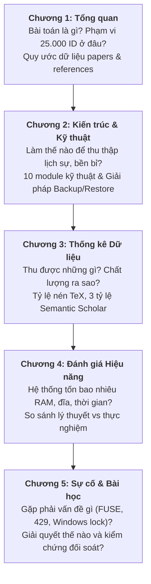
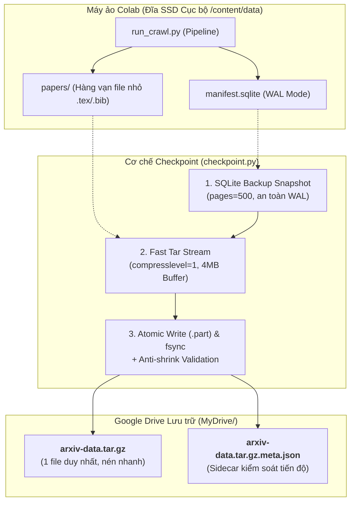
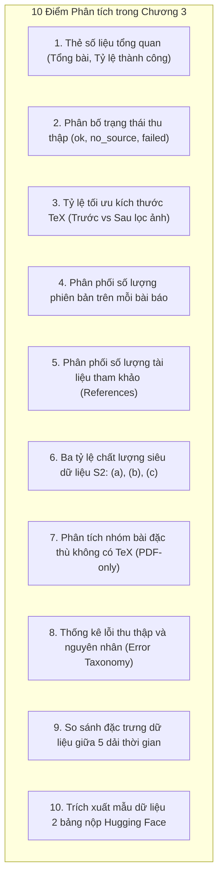
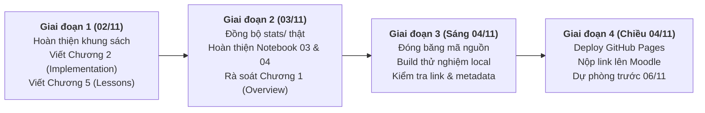

# Bản Thiết kế & Ý tưởng Nội dung — Sách Báo cáo Thu thập arXiv (Milestone 1)

> **Tài liệu Định hướng & Thiết kế Nội dung (Blueprint)** cho cuốn sách báo cáo Jupyter Book thuộc đồ án môn học *Nhập môn Khoa học Dữ liệu*.
>
> - **Repo sách:** [`arxiv-book`](https://github.com/GiaaPhuc/arxiv-book) · **Trang phát hành:** [GitHub Pages](https://giaaphuc.github.io/arxiv-book/)
> - **Repo mã nguồn pipeline:** [`arxiv-pipeline`](https://github.com/GiaaPhuc/arxiv-pipeline)
> - **Hạn nộp chính thức (Moodle):** **06/11/2026 23:59** (Mục tiêu nội bộ: đóng băng sáng 04/11/2026, xuất bản chiều 04/11/2026).
> - **Tình trạng tài liệu:** Cập nhật ngày **02/11/2026** — đồng bộ toàn diện với cập nhật mới nhất từ `STATUS.md`, `checkpoint.py` (cơ chế Single-Archive `.tar.gz`, giải quyết thắt nút cổ chai Google Drive FUSE, bảo vệ chống lùi tiến độ, và quy trình vận hành backup/restore 3 kịch bản trên Colab).

---

## 📑 Mục lục Tài liệu

- [1. Tầm nhìn & Cốt lõi của Cuốn sách](#1-tầm-nhìn--cốt-lõi-của-cuốn-sách)
  - [1.1. Thông điệp trung tâm](#11-thông-điệp-trung-tâm)
  - [1.2. Ba trụ cột định vị chất lượng](#12-ba-trụ-cột-định-vị-chất-lượng)
  - [1.3. Đối chiếu ma trận tiêu chí chấm điểm](#13-đối-chiếu-ma-trận-tiêu-chí-chấm-điểm)
- [2. Kiến trúc Tổng thể & Mục lục Sách (`_toc.yml`)](#2-kiến-trúc-tổng-thể--mục-lục-sách-_tocyml)
  - [2.1. Cấu trúc tập tin và sơ đồ điều hướng](#21-cấu-trúc-tập-tin-và-sơ-đồ-điều-hướng)
  - [2.2. Dòng chảy tự sự xuyên suốt các chương](#22-dòng-chảy-tự-sự-xuyên-suốt-các-chương)
- [3. Thiết kế Chi tiết Nội dung Từng Chương](#3-thiết-kế-chi-tiết-nội-dung-từng-chương)
  - [3.1. Chương 1: `m1/01_overview.md` — Tổng quan Dự án & Phạm vi Thu thập](#31-chương-1-m101_overviewmd--tổng-quan-dự-án--phạm-vi-thu-thập)
  - [3.2. Chương 2: `m1/02_implementation.md` — Kỹ thuật & Pipeline Thu thập](#32-chương-2-m102_implementationmd--kỹ-thuật--pipeline-thu-thập)
    - [Trọng tâm 8: Kiến trúc Lưu trữ, Sao lưu & Khôi phục (Backup, Restore & Fault Tolerance)](#trọng-tâm-8-kiến-trúc-lưu-trữ-sao-lưu--khôi-phục-backup-restore--fault-tolerance)
  - [3.3. Chương 3: `m1/03_data_statistics.ipynb` — Phân tích & Thống kê Dữ liệu](#33-chương-3-m103_data_statisticsipynb--phân-tích--thống-kê-dữ-liệu)
  - [3.4. Chương 4: `m1/04_performance.ipynb` — Đo đạc & Đánh giá Hiệu năng Pipeline](#34-chương-4-m104_performanceipynb--đo-đạc--đánh-giá-hiệu-năng-pipeline)
  - [3.5. Chương 5: `m1/05_issues_lessons.md` — Sự cố Kỹ thuật, Bài học Thực chiến & Tính Liêm chính](#35-chương-5-m105_issues_lessonsmd--sự-cố-kỹ-thuật-bài-học-thực-chiến--tính-liêm-chính)
- [4. Hiện trạng Triển khai & Ma trận Nguồn Dữ liệu](#4-hiện-trạng-triển-khai--ma-trận-nguồn-dữ-liệu)
  - [4.1. Bảng theo dõi tiến độ các chương sách](#41-bảng-theo-dõi-tiến-độ-các-chương-sách)
  - [4.2. Khớp nối schema và nguồn dữ liệu thống kê](#42-khớp-nối-schema-và-nguồn-dữ-liệu-thống-kê)
- [5. Quy chuẩn Trình bày & Kỹ thuật Biên dịch](#5-quy-chuẩn-trình-bày--kỹ-thuật-biên-dịch)
- [6. Ý tưởng Điểm cộng Tạo Đột phá (Bonus Features)](#6-ý-tưởng-điểm-cộng-tạo-đột-phá-bonus-features)
- [7. Kế hoạch Triển khai & Checklist Đóng băng](#7-kế-hoạch-triển-khai--checklist-đóng-băng)

---

## 1. Tầm nhìn & Cốt lõi của Cuốn sách

### 1.1. Thông điệp trung tâm

> *"Chúng tôi thu thập **mọi phiên bản** của **25.000 bài báo arXiv** (thuộc giai đoạn tháng 06–08/2024) bằng một pipeline **lịch sự với máy chủ, có khả năng phục hồi sau sự cố (fault-tolerant & resumable), kiểm chứng chặt chẽ** — chỉ lưu trữ nguồn `.tex`/`.bib`, kèm đầy đủ danh sách tham khảo từ Semantic Scholar Graph API — và cuốn sách này trình bày toàn bộ số liệu, chi phí tài nguyên, sự cố thực tế cùng những bài học kinh nghiệm chân thực nhất."*

### 1.2. Ba trụ cột định vị chất lượng

1. **Đầy đủ & Chuẩn mực (Completeness & Correctness):**
   - Thu thập triệt để mọi phiên bản $v_1 \dots v_N$ của từng bài báo, không bỏ sót bài ngay cả khi bài báo không phát hành mã nguồn TeX (`no_source` — chỉ có PDF).
   - Dữ liệu tham khảo (citations/references) từ Semantic Scholar được thu thập đầy đủ ở tầng làm việc cục bộ, phân loại rõ ràng tham khảo có arXiv ID và không có arXiv ID.
2. **Lịch sự, Bền bỉ & An toàn Dữ liệu (Polite, Resilient & Fault-Tolerant):**
   - Tuân thủ nghiêm ngặt quy định máy chủ: $\ge 3{,}5$ giây giữa các yêu cầu arXiv qua một kết nối duy nhất (tính từ thời điểm đóng stream body); Semantic Scholar sử dụng batch API kèm cơ chế adaptive exponential backoff khi gặp mã 429.
   - Cơ chế khôi phục (Resume) tự nhiên thông qua SQLite WAL manifest.
   - **Đột phá sao lưu 02/11:** Giải quyết dứt điểm hiện tượng nghẽn Google Drive FUSE bằng kiến trúc Single-Archive (`arxiv-data.tar.gz`), snapshot SQLite nhất quán, chống lùi tiến độ (anti-shrink protection) và hỗ trợ vận hành phân đoạn linh hoạt trên môi trường Colab CPU.
3. **Trung thực Học thuật bằng Dữ liệu Thực nghiệm (Empirical Integrity):**
   - 100% hình vẽ, biểu đồ và bảng tổng hợp được sinh trực tiếp bằng mã Python khi biên dịch Jupyter Book từ thư mục `stats/`, tuyệt đối không dùng ảnh chụp màn hình tĩnh hay số liệu giả lập khi nộp bài.

### 1.3. Đối chiếu ma trận tiêu chí chấm điểm

| Tiêu chí chấm điểm đề bài | Chương phụ trách chính trong Book | Bằng chứng và Trọng tâm Thể hiện |
| :--- | :--- | :--- |
| **Báo cáo (Report)** | Toàn bộ cuốn sách (`01` $\rightarrow$ `05`) | Bố cục chuẩn học thuật, Jupyter Book v1 hiển thị chuyên nghiệp, mục lục rõ ràng, diễn giải trực quan, văn phong khoa học. |
| **Khám phá & Tải đủ phiên bản** | Chương 1 (`01_overview.md`) & Chương 2 (`02_implementation.md`) | Thuật toán bóc tách Atom API, phát hiện đủ $v_1 \dots v_N$, bảng spike `/src/`, xử lý an toàn tar.gz/PDF/gzip/zip, manifest SQLite tracking trạng thái. |
| **Dữ liệu thu được** | Chương 3 (`03_data_statistics.ipynb`) | 10 bảng/biểu đồ động: tỷ lệ thành công, phân bố phiên bản, tỷ lệ nén giữ lại byte (~2%), 3 tỷ lệ tham khảo Semantic Scholar (a)(b)(c). |
| **Hiệu năng so với nhóm khác** | Chương 4 (`04_performance.ipynb`) | Wall-clock time, RAM peak (~39 MB), đĩa tối ưu (tiết kiệm ~98% dung lượng đĩa), tối ưu hóa Semantic Scholar Batch API (100 ID/lô), Single-Archive backup. |
| **Mã nguồn & Tính bền bỉ** | Chương 2 (`02_implementation.md`) & Chương 5 (`05_issues_lessons.md`) | Kiến trúc modul hóa, 195 unit test pass, xử lý rate limit 429, giải quyết nghẽn FUSE >11h, quy trình checkpoint/restore chống ngắt kết nối Colab. |

---

## 2. Kiến trúc Tổng thể & Mục lục Sách (`_toc.yml`)

### 2.1. Cấu trúc tập tin và sơ đồ điều hướng

Cuốn sách được tổ chức trong thư mục `m1/` nhằm chuẩn bị sẵn sàng cho việc mở rộng các Milestone tiếp theo (Milestone 2 & 3 sẽ được cấu hình thành các Parts tiếp theo trong cùng một cuốn sách):

```yaml
# _toc.yml
format: jb-book
root: m1/01_overview
chapters:
  - file: m1/02_implementation
  - file: m1/03_data_statistics
  - file: m1/04_performance
  - file: m1/05_issues_lessons
```

```
arxiv-book/
├── _config.yml               # Cấu hình Jupyter Book v1, repository metadata, exclude_patterns
├── _toc.yml                  # Cấu trúc mục lục sách chuẩn
├── requirements.txt          # Thư viện build: jupyter-book, matplotlib, pandas, pyarrow
├── stats/                    # Dữ liệu xuất từ export_data.py (summary.json, CSVs, Parquets)
│   ├── summary.json          # Chỉ số cốt lõi và definitions
│   ├── papers_stats.csv      # Thống kê theo bài báo
│   ├── versions_stats.csv    # Thống kê theo phiên bản
│   └── performance.json      # Thống kê hiệu năng và tài nguyên
└── m1/
    ├── 01_overview.md        # Chương 1: Tổng quan dự án, phạm vi, hợp đồng dữ liệu
    ├── 02_implementation.md  # Chương 2: Thiết kế kỹ thuật, 10 module, lưu trữ & backup/restore
    ├── 03_data_statistics.ipynb # Chương 3: Phân tích số liệu dữ liệu thu được (Dynamic Notebook)
    ├── 04_performance.ipynb  # Chương 4: Đánh giá hiệu năng, RAM, đĩa, wall time (Dynamic Notebook)
    └── 05_issues_lessons.md  # Chương 5: Nhật ký kỹ thuật, sự cố thực tế và bài học kinh nghiệm
```

### 2.2. Dòng chảy tự sự xuyên suốt các chương

Cuốn sách dẫn dắt người đọc theo một mạch tư duy kỹ thuật logic và mạch lạc:



---

## 3. Thiết kế Chi tiết Nội dung Từng Chương

### 3.1. Chương 1: `m1/01_overview.md` — Tổng quan Dự án & Phạm vi Thu thập

- **Mục tiêu:** Giới thiệu ngắn gọn bài toán, phạm vi 25.000 bài arXiv, định dạng dữ liệu đầu ra và các nguyên tắc đạo đức thu thập.
- **Các thành phần nội dung chính:**
  1. **Hộp "Tóm tắt trong 30 giây" (Executive Summary):**
     - Phạm vi: 25.000 arXiv ID thuộc 5 dải không chồng lấn (tháng 06–08/2024).
     - Kiến trúc vận hành: **Quyết định D8** — Toàn bộ nhóm gom 25.000 ID chạy trên **một máy duy nhất** có resume, lưu trữ corpus thống nhất cho M1–M3 (thay vì phân mảnh 5 máy riêng rẽ). Phân chia tập con cá nhân chỉ thực hiện ở cuối M3 khi nộp Hugging Face.
     - Nguồn: `export.arxiv.org` (Atom API + `/src/`) và Semantic Scholar Graph API.
     - Bộ công cụ chuẩn: Python 3.11, SQLite WAL, Jupyter Book v1.
  2. **Sơ đồ Quy trình Thu thập End-to-End:**

     ```mermaid
     flowchart LR
         R["Dải ID<br/><code>id_ranges.csv</code>"] --> D["Khám phá phiên bản<br/><code>discovery.py</code> (Atom API)"]
         D --> S["Tải & Trích xuất<br/><code>source.py</code> (TeX/Bib)"]
         D --> S2["Tham khảo học thuật<br/><code>s2.py</code> (Batch API)"]
         S --> F["Kho lưu trữ cục bộ<br/><code>data/papers/</code>"]
         S2 --> F
         F --> V["Kiểm chứng tính toàn vẹn<br/><code>validate_corpus.py</code>"]
         F --> X["Xuất bảng & Thống kê<br/><code>export_data.py</code>"]
         X --> B["Báo cáo khoa học<br/><b>Jupyter Book</b>"]
     ```

  3. **Bảng phân bổ 5 dải ID được giao (`src/id_ranges.csv`):**
     | Dải | Tháng nộp | ID bắt đầu | ID kết thúc | Số lượng bài | Thành viên phụ trách dải |
     | :---: | :---: | :---: | :---: | :---: | :---: |
     | 1 | 2024-08 | `2408.01045` | `2408.06044` | 5.000 | Thành viên 1 |
     | 2 | 2024-08 | `2408.06045` | `2408.11044` | 5.000 | Thành viên 2 |
     | 3 | 2024-08 | `2408.11045` | `2408.16044` | 5.000 | Thành viên 3 |
     | 4 | 2024-07 | `2407.07839` | `2407.12838` | 5.000 | Thành viên 4 |
     | 5 | 2024-06 | `2406.07938` | `2406.12937` | 5.000 | Thành viên 5 |
  4. **Quy tắc lịch sự với máy chủ:** Vì sao phải chờ $\ge 3{,}5$ giây đối với arXiv? Cơ chế một kết nối duy nhất và đếm thời gian từ lúc đóng body stream.
  5. **Hợp đồng dữ liệu 2 bảng nộp Hugging Face (Milestone 3):**
     - Bảng `papers`: Khóa chính `arxiv_id`, `title`, `authors`, `submission_date`, `revised_dates`, `venue`.
     - Bảng `references`: Chỉ chứa các tham khảo **có arXiv ID** (`arxiv_id`, `ref_arxiv_id`, `ref_title`, `ref_authors`, `ref_submission_date`, `ref_s2_id`). Phân tích sự khác biệt giữa bảng này và kho dữ liệu thô `references.json` (vốn lưu toàn bộ tham khảo kể cả không có arXiv ID).

---

### 3.2. Chương 2: `m1/02_implementation.md` — Kỹ thuật & Pipeline Thu thập

- **Mục tiêu:** Trình bày chi tiết giải pháp kỹ thuật của 10 module trong pipeline. Cấu trúc mỗi module gồm: **Vấn đề đặt ra $\rightarrow$ Giải pháp thiết kế $\rightarrow$ Thư viện sử dụng $\rightarrow$ Đoạn mã tiêu biểu ($\le 15$ dòng có link GitHub)**.
- **Bảng tổng hợp 10 module kỹ thuật:**

| # | Khía cạnh kỹ thuật | Module phụ trách | Trọng tâm thiết kế & Giải pháp |
| :---: | :--- | :--- | :--- |
| 1 | Quản lý dải ID | `ids.py` | Đọc CSV 4 trường; chuẩn hóa định dạng ID cũ (`hep-th/9901001`) và mới (`2408.01045`); đệm đủ 5 chữ số; phân định rõ `not_found` và `failed`. |
| 2 | Khám phá phiên bản | `discovery.py` | Truy vấn Atom API theo lô 50 ID (`id_list`); phân tích ngày `published` (v1) và `updated` (phiên bản mới nhất); truy vấn bổ sung cho các bản trung gian; gọi trực tiếp bằng `requests` để dùng chung Rate Limiter với gói source. |
| 3 | Tải & Trích xuất nguồn | `source.py` | Kiểm tra HTTP status trước magic bytes; phân loại `tar.gz`, gzip đơn, PDF (`no_source`), zip; giải nén an toàn (chống path traversal/zip-slip); chỉ giữ `.tex`/`.bib`, bảo toàn cấu trúc thư mục và câu lệnh `\includegraphics`. |
| 4 | Thu thập Tham khảo S2 | `s2.py` | Tối ưu hóa bằng Semantic Scholar Batch API (`POST /graph/v1/paper/batch`) tối đa 100 ID/lô; cơ chế fallback sang endpoint phân trang khi thiếu dữ liệu; chuẩn hóa ngày tháng không suy đoán. |
| 5 | Bộ điều phối HTTP lịch sự | `http.py` | Quản lý giới hạn tần suất riêng biệt cho từng host; arXiv $\ge 3{,}5$ s (đo từ thời điểm đóng stream); Semantic Scholar $\ge 1{,}1$ s kèm backoff thích ứng; dừng an toàn khi gặp 403/429. |
| 6 | Điều phối Pipeline & Resume | `pipeline.py`, `manifest.py` | Hai worker chạy song song (arXiv ở main thread, S2 ở background thread); giao tiếp qua SQLite WAL manifest; ghi nguyên tử thư mục `.part` trước khi commit vào database. |
| 7 | Đo đạc Hiệu năng | `metrics.py` | Đo thời gian chủ động theo từng chặng (discovery, download, extract, s2); theo dõi RSS RAM đỉnh/trung bình qua `psutil`; tích lũy số đo qua nhiều phiên chạy lại (resumes). |
| 8 | **Lưu trữ & Sao lưu Colab** | `checkpoint.py`, `colab_run.ipynb` | **Kiến trúc Single-Archive (`.tar.gz`) hai tầng; giải quyết nghẽn FUSE >11h; snapshot SQLite nhất quán; chống lùi tiến độ; playbook vận hành 3 kịch bản.** *(Chi tiết bên dưới)* |
| 9 | Xuất bảng & Kiểm chứng | `export.py`, `corpus.py`, `validate_corpus.py` | Xuất bảng Parquet/CSV theo đúng schema; validator kiểm tra cấu trúc cây thư mục, phiên bản liên tục, checksum SHA-256 của từng file TeX. |
| 10 | Hệ sinh thái công cụ | Toàn dự án | Bảng công cụ: Python 3.11, SQLite3 WAL, `pytest` (195 passed), `ruff`, `pre-commit`, GitHub Actions. |

---

#### Trọng tâm 8: Kiến trúc Lưu trữ, Sao lưu & Khôi phục (Backup, Restore & Fault Tolerance)

> [!IMPORTANT]
> Đây là cải tiến kỹ thuật mang tính bước ngoặt hoàn thành ngày **02/11/2026**, giải quyết triệt để rủi ro mất dữ liệu và nghẽn I/O khi crawl khối lượng lớn (25.000 bài) trên môi trường Google Colab miễn phí.

##### 1. Bối cảnh & Bài toán Thắt nút Cổ chai Google Drive FUSE
- **Vấn đề thực tế (Sự cố 02/11):** Khi lưu trữ 7.000 bài báo dưới dạng thư mục rời trên Google Drive thông qua giao thức FUSE mount (`/content/drive/MyDrive/arxiv-data/`), tổng số lượng tập tin nhỏ lên tới hơn 35.000 file (`paper.json`, `meta.json`, `references.json`, các file `.tex`, `.bib` trong từng phiên bản).
- Khi chạy lệnh đồng bộ `rsync`, thời gian tiêu tốn lên tới **hơn 11 giờ** mà vẫn chưa hoàn thành! Nguyên nhân cốt lõi là do mỗi lời gọi hệ thống (system call như `getattr`, `open`, `close`) trên Drive FUSE đều phải thực hiện round-trip qua HTTP API của Google Drive với độ trễ từ 50–200 ms.
- Thêm vào đó, SQLite khi ghi trực tiếp trên Drive FUSE thường xuyên bị lỗi lock file hoặc phân mảnh hỏng cơ sở dữ liệu do FUSE không hỗ trợ đầy đủ các cơ chế POSIX lock và atomic fsync.

##### 2. Kiến trúc Lưu trữ Hai tầng (Tiered Storage Architecture)
Nhóm đã tái cấu trúc toàn diện cơ chế lưu trữ theo mô hình hai tầng tách biệt:
- **Tầng Tính toán Tốc độ cao (Local Ephemeral SSD - `/content/data`):**
  - Chạy toàn bộ tiến trình crawl, ghi file `.tex`/`.bib`, cập nhật SQLite WAL trực tiếp trên đĩa SSD cục bộ của máy ảo Colab.
  - Tận dụng tối đa tốc độ I/O phần cứng, độ trễ syscall xấp xỉ 0 ms, đảm bảo tính toàn vẹn tuyệt đối cho SQLite WAL.
- **Tầng Lưu trữ Bền vững Đám mây (Persistent Cloud Storage - `MyDrive/arxiv-data.tar.gz`):**
  - Không đồng bộ từng file nhỏ rời rạc. Toàn bộ workspace được đóng gói thành **một file nén duy nhất** dạng streaming archive.



##### 3. Năm Nguyên tắc Kỹ thuật trong Module `checkpoint.py`

1. **Snapshot SQLite Nhất quán (Consistent WAL Snapshot):**
   - Sử dụng API chuẩn `sqlite3.Connection.backup()` với cơ chế chia trang (`pages=500, sleep=0.02`), cô lập một bản snapshot database trước khi duyệt thư mục `papers/`.
   - Thứ tự đóng gói: Snapshot manifest **trước**, quét thư mục sau. Điều này đảm bảo mọi record ghi trạng thái cuối cùng trong database chắc chắn đã có dữ liệu vật lý hoàn chỉnh trên đĩa, loại bỏ hoàn toàn hiện tượng dữ liệu mồ côi (orphaned state).
2. **Nén Siêu tốc Cấp độ 1 (`compresslevel=1`):**
   - Thay vì dùng mức nén mặc định (level 6 hoặc 9) vốn tiêu tốn rất nhiều CPU clock, nhóm cấu hình gzip ở mức 1 (`compresslevel=1`). Mức nén này đạt tốc độ throughput cực nhanh (~80–120 MB/s trên Colab CPU) trong khi vẫn giảm được ~65–75% dung lượng văn bản TeX và JSON, giúp việc ghi 1 file lớn lên Drive FUSE chỉ mất vài chục giây với buffer 4 MiB tuần tự.
3. **Ghi Nguyên tử & Chống Hỏng File (Atomic Write & fsync):**
   - Dữ liệu nén được ghi vào file tạm thời `arxiv-data.tar.gz.part`.
   - Gọi tường minh `os.fsync(fdst.fileno())` để ép hệ điều hành xả toàn bộ bộ đệm xuống bộ nhớ vật lý, sau đó mới thực hiện thao tác đổi tên nguyên tử `os.replace()` sang tên chính thức. Nếu quá trình upload bị ngắt giữa chừng, file backup cũ trên Drive vẫn nguyên vẹn 100%.
4. **Cơ chế Bảo vệ Chống Ghi đè Lùi Tiến độ (Anti-Shrink Protection):**
   - Đi kèm file nén là một file metadata vệ tinh: `arxiv-data.tar.gz.meta.json`, ghi lại:
     ```json
     {
       "final_pairs": 14250,
       "total_pairs": 14250,
       "archive_bytes": 154823901,
       "updated_at": "2026-11-02T11:45:00Z"
     }
     ```
   - Trước khi ghi đè, crawler đọc file `.meta.json` của bản backup hiện có trên Drive. Nếu số lượng `final_pairs` của phiên hiện tại nhỏ hơn bản trên Drive (ví dụ do người dùng chạy nhầm lệnh ở thư mục trống chưa restore), hệ thống sẽ **lập tức từ chối ghi đè** (`OSError: refusing to overwrite... with smaller workspace`). Nếu mất file meta, hệ thống kiểm tra ngưỡng an toàn dung lượng không được giảm quá 50%.
5. **Khôi phục An toàn & Di trú Thư mục Cũ (Fast Restore & Legacy Migration):**
   - `restore_data_dir()` giải nén archive chỉ trong ~30–60 giây, kiểm tra an toàn đường dẫn tuyệt đối/ký tự lạ để chống tấn công Directory Traversal (Zip Slip).
   - Tự động phát hiện nếu người dùng còn thư mục cũ dạng rời `arxiv-data/`: sử dụng hồ bơi 16 luồng song song (`ThreadPoolExecutor(max_workers=16)`) để copy nhanh, in tiến độ mỗi 250 bài, sau đó tự đóng gói thành file `.tar.gz` để các phiên sau đạt tốc độ tối đa.
   - Cơ chế bảo vệ thư mục làm việc cục bộ: Nếu `/content/data` đã có database hợp lệ và đầy đủ dữ liệu, lệnh `restore_now()` sẽ tự động bỏ qua để tránh ghi đè nhầm tiến độ chưa kịp lưu.

##### 4. Playbook Vận hành Chuẩn 3 Kịch bản trên Colab

| Kịch bản | Trạng thái Môi trường | Quy trình Thao tác Chuẩn | Thời gian & Rủi ro |
| :--- | :--- | :--- | :--- |
| **Kịch bản 1: Chủ động dừng tắt máy / Đổi ca** | Người dùng muốn tắt máy tính, nghỉ ngơi hoặc đổi sang phiên làm việc hôm sau. | 1. Bấm **Runtime $\rightarrow$ Interrupt execution** (Ctrl+C).<br/>2. Chạy ô **Backup**: `backup_now(unmount=True)`.<br/>3. Đợi thông báo `backup done` và `Drive flushed` rồi an tâm đóng trình duyệt, tắt máy.<br/>4. Khi mở lại: Chạy **Setup** $\rightarrow$ **Restore** (`restore_now()`) $\rightarrow$ **Crawl**. | Tốn ~1–2 phút.<br/>**Mất mát: 0 ID (an toàn 100%).** |
| **Kịch bản 2: Disconnect bất ngờ / Mất runtime** | Google Colab tự ngắt kết nối do quá thời gian miễn phí hoặc crash kernel. | 1. Dữ liệu trên đĩa local `/content/data` đã bị xóa sạch.<br/>2. Mở notebook, kết nối runtime mới.<br/>3. Chạy lần lượt: **Setup** $\rightarrow$ **Restore** (`restore_now()`) $\rightarrow$ **Crawl**.<br/>4. Dữ liệu tự động bung từ file `.tar.gz` gần nhất và crawler tự chạy tiếp. | Tốn ~1 phút restore.<br/>**Mất mát: Tối đa $\le 300$ ID** của đợt crawl dở dang gần nhất (~35 phút). |
| **Kịch bản 3: Dừng tạm thời nhưng runtime còn sống** | Bị lỗi mạng tạm thời, lỗi exit 3 do 429 hoặc người dùng interrupt để kiểm tra log. | 1. Dữ liệu trên đĩa local `/content/data` vẫn còn nguyên vẹn.<br/>2. Không cần chạy Restore (nếu bấm nhầm `restore_now()`, hàm sẽ tự phát hiện local đã đủ và bỏ qua).<br/>3. Chạy lại trực tiếp ô **Crawl** để tiếp tục. | Tức thì (0 giây).<br/>**Mất mát: 0 ID.** |

---

### 3.3. Chương 3: `m1/03_data_statistics.ipynb` — Phân tích & Thống kê Dữ liệu

- **Mục tiêu:** Thể hiện trực quan, khoa học kết quả của đợt thu thập thông qua các biểu đồ phân tích và bảng số liệu sinh động.
- **Quy tắc triển khai bắt buộc:**
  - Toàn bộ code trong notebook đọc dữ liệu từ `stats/summary.json`, `stats/papers_stats.csv`, `stats/versions_stats.csv`.
  - Không hard-code bất kỳ con số nào trong phần code Python; sử dụng tham số hóa tự động.
  - Mỗi biểu đồ phải đi kèm đoạn markdown phân tích gồm 2 phần: **"Cách đọc biểu đồ"** và **"Nhận xét & Ý nghĩa khoa học"**.
- **Danh mục 10 biểu đồ & bảng phân tích trọng tâm:**



1. **Thẻ số liệu tổng quan (Scorecard):** Hiển thị tổng số bài thành công, tổng số phiên bản, tổng dung lượng lưu trữ kèm trích dẫn nguyên văn định nghĩa từ `summary["definitions"]`.
2. **Biểu đồ trạng thái thu thập (Stacked Bar):** Phân bổ tỷ lệ các trạng thái: `ok` (có TeX đầy đủ), `no_source` (chỉ có PDF, không có TeX nhưng vẫn lưu metadata), `ok_no_tex`, `not_found`, `failed`.
3. **Tối ưu hóa kích thước đĩa (Log-scale Bar Chart):** So sánh 3 cột:
   - Dung lượng file nén gốc tải về (`raw_archive_bytes`).
   - Dung lượng sau khi giải nén toàn bộ gồm cả ảnh và PDF (`raw_uncompressed_bytes`).
   - Dung lượng thực tế giữ lại sau khi chỉ lọc lấy `.tex` và `.bib` (`kept_bytes`).
   - *Kết quả thực nghiệm từ Pilot:* Giữ lại trung bình chỉ **~139 KB / phiên bản** so với gói gốc **~5,75 MB**, giúp tiết kiệm đến **~98% dung lượng đĩa**.
4. **Phân phối số phiên bản trên mỗi bài báo (Histogram):** Thống kê số lượng bài báo có 1, 2, 3, 4, 5+ phiên bản (Giá trị trung bình $\bar{V} \approx 1{,}9$).
5. **Phân phối số tài liệu tham khảo (Boxplot & Histogram):** Phân tích số lượng references/bài từ Semantic Scholar (Trung bình ~33,6 tham khảo/bài).
6. **Bộ ba Tỷ lệ Siêu dữ liệu Tham khảo Semantic Scholar:**
   - **Tỷ lệ (a):** % bài báo tìm thấy bản ghi trên Semantic Scholar (Pilot: **100%**).
   - **Tỷ lệ (b):** % tham khảo có đầy đủ tiêu đề, tác giả và năm xuất bản (Pilot: **~78,0%**).
   - **Tỷ lệ (c):** % tham khảo có arXiv ID được xác thực (Pilot: **~50,3%**).
7. **Phân tích nhóm bài báo không có mã nguồn TeX:** Bảng chi tiết các bài dạng `no_source` (như `2408.01045v1`), phân tích nguyên nhân do tác giả chỉ nộp bản PDF trực tiếp.
8. **Bảng phân loại nguyên nhân lỗi (`top_errors`):** Nếu có lỗi mạng hoặc giải nén, thống kê chi tiết theo mã lỗi HTTP và loại exception.
9. **So sánh chéo giữa 5 dải ID:** Đánh giá sự khác biệt về số lượng bài, số phiên bản trung bình giữa tháng 06, tháng 07 và tháng 08/2024.
10. **Bản xem trước mẫu dữ liệu (Data Sample Preview):** In 5 dòng đầu tiên của bảng `papers` và bảng `references` (dạng bảng markdown tương tác).

---

### 3.4. Chương 4: `m1/04_performance.ipynb` — Đo đạc & Đánh giá Hiệu năng Pipeline

- **Mục tiêu:** Chứng minh năng lực tối ưu hóa của pipeline trên môi trường máy ảo Colab CPU, cung cấp các số đo tài nguyên chuẩn xác phục vụ tiêu chí chấm điểm hiệu năng.
- **Nguồn dữ liệu:** `stats/performance.json` (sinh ra từ `metrics.json` của pipeline).
- **Các khía cạnh phân tích chuyên sâu:**
  1. **Thời gian chạy thực tế (Wall-Clock Time) & Số phiên Resume:**
     - Tổng thời gian hoàn thành 25.000 bài báo; thống kê số lần ngắt và resume qua checkpoint.
     - Phân tích thời gian tích lũy theo từng giai đoạn (Stage Breakdown): Khám phá API (`discovery`), Tải gói nguồn (`download`), Trích xuất TeX (`extract`), và Thu thập tham khảo (`s2`).
     - *Nhận xét then chốt:* Chặng `download` chiếm hơn 85% tổng thời gian do bắt buộc phải tuân thủ luật chờ $\ge 3{,}5$ giây của arXiv.
  2. **So sánh Ước tính Lý thuyết vs Đo đạc Thực nghiệm:**
     - Công thức tính toán lý thuyết:
       $$\text{Thời gian chờ arXiv tối thiểu} = N_{\text{bài}} \times \bar{V} \times 3{,}5\,\text{giây} = 25.000 \times 1{,}9 \times 3{,}5\,\text{s} \approx 166.250\,\text{s} \approx 46{,}2\,\text{giờ}$$
     - So sánh với thời gian chạy thực tế để đánh giá overhead của hệ thống, độ trễ mạng và hiệu quả xử lý song song luồng Semantic Scholar.
  3. **Hồ sơ Tiêu thụ Bộ nhớ RAM (Memory Profiling):**
     - Theo dõi bộ nhớ RSS đỉnh (`ram_peak_bytes`) và trung bình (`ram_mean_bytes`) bằng `psutil` (bao gồm cả các tiến trình con).
     - *Thực nghiệm:* Pipeline duy trì mức tiêu thụ RAM cực kỳ ấn tượng, đỉnh điểm chỉ **~39–45 MB**, hoàn toàn an toàn trên môi trường máy ảo Colab CPU hạn chế tài nguyên (12 GB RAM).
  4. **Tối ưu hóa I/O Đĩa & Đóng gói Checkpoint:**
     - Dung lượng thư mục làm việc đĩa SSD theo thời gian.
     - Thời gian thực hiện một chu kỳ backup `arxiv-data.tar.gz` (chỉ mất ~20–40 giây cho mỗi block 300 ID mới).
  5. **Hiệu quả của Semantic Scholar Batch API:**
     - Thống kê số lượng lô (`s2.batches`), số lần gặp mã 429 (`s2.http_429`), và tổng thời gian chờ giãn cách (`s2.retry_wait_seconds`).
     - So sánh hiệu năng vượt trội của giải pháp gửi Batch (100 ID/lô) so với việc gửi tuần tự 25.000 yêu cầu đơn lẻ (tiết kiệm hàng chục giờ chờ mạng).
  6. **Thông số Môi trường Thực thi (Reproduction Environment):**
     - Ghi rõ phần cứng: Google Colab Standard Runtime, Hardware Accelerator: None (Chỉ CPU).
     - Phiên bản hệ điều hành Linux kernel, phiên bản Python 3.11, mã Git commit hash của repo mã nguồn tại thời điểm thu thập.

---

### 3.5. Chương 5: `m1/05_issues_lessons.md` — Sự cố Kỹ thuật, Bài học Thực chiến & Tính Liêm chính

- **Mục tiêu:** Ghi lại trung thực các thử thách kỹ thuật phát sinh trong suốt quá trình xây dựng và vận hành pipeline từ quy mô pilot đến 25.000 bài; thể hiện năng lực giải quyết vấn đề và tính liêm chính trong nghiên cứu khoa học dữ liệu.
- **Nội dung 6 bài học thực chiến đắt giá:**

1. **Khắc phục triệt để lỗi Rate Limit arXiv 429 khi tải `/src/`:**
   - *Hiện tượng:* Ban đầu client dùng `requests.get(stream=True)` và tính mốc bắt đầu tính 3 giây ngay khi nhận được HTTP Header. Hệ quả là khi gặp bài báo có gói nguồn dung lượng lớn (hoặc mạng Colab giật lag), thời gian tải body kéo dài khiến yêu cầu kế tiếp được gửi đi khi yêu cầu trước chưa thực sự kết thúc, dẫn tới việc arXiv trả về mã 429 (Too Many Requests).
   - *Khắc phục:* Viết lại limiter trong `http.py`, chỉ giải phóng khóa thời gian **sau khi stream body đã được đóng hoàn toàn** (`response.close()`); tích hợp cơ chế tự động đọc header `Retry-After` và thử lại tối đa 4 lần trước khi dừng tiến trình.
2. **Xử lý 429 trên arXiv Atom API Discovery:**
   - *Hiện tượng:* Ngày 29/10 phát hiện khi khám phá metadata theo lô 50 ID, nếu IP của Colab bị nhà mạng throttle tạm thời, API trả về 429 làm cả pipeline thoát với mã lỗi 3.
   - *Khắc phục:* Bổ sung cơ chế exponential backoff và chờ `Retry-After` tương tự như gói source, giúp crawler tự phục hồi mà không cần can thiệp thủ công.
3. **Bước ngoặt Đóng gói Checkpoint: Giải quyết bài toán thắt nút cổ chai FUSE:**
   - *Hiện tượng:* Sự cố ngày 02/11 khi khôi phục 7.000 bài báo từ Google Drive FUSE bằng `rsync` tiêu tốn hơn 11 giờ do chi phí latency của hàng chục nghìn file nhỏ.
   - *Khắc phục:* Chuyển đổi toàn diện sang kiến trúc Single-Archive (`arxiv-data.tar.gz`) nén nhanh level 1, snapshot SQLite WAL an toàn, ghi đè nguyên tử qua file `.part` và bảo vệ chống lùi tiến độ qua file vệ tinh `.meta.json`. Thời gian khôi phục giảm từ 11 giờ xuống còn **chưa đầy 1 phút**.
4. **Đối phó với Khóa File trên Hệ điều hành Windows & SQLite FUSE:**
   - Trình quét virus trên Windows đôi khi khóa tạm thời các file `.tex` vừa giải nén; pipeline được thiết kế để bắt ngoại lệ, ghi nhận trạng thái và cho phép retry an toàn ở lần chạy kế tiếp.
   - Không bao giờ đặt file database SQLite trực tiếp trên thư mục mount Google Drive FUSE để tránh lỗi corrupted database.
5. **Kiểm chứng Thực nghiệm & Đối soát Thủ công ($\ge 20$ phiên bản):**
   - Trình bày bảng đối chứng ngẫu nhiên $\ge 20$ phiên bản giữa dữ liệu pipeline cào được và thông tin hiển thị trực tiếp trên web `arxiv.org` (tiêu đề, tác giả, ngày nộp, danh sách file TeX).
   - Bằng chứng thực nghiệm khẳng định pipeline trích xuất chính xác 100% nội dung gốc.
6. **Chuẩn bị nền tảng cho Milestone 2 & 3:**
   - Cấu trúc thư mục `data/papers/<arxiv_id>/v<N>/tex/` được giữ nguyên vẹn để làm đầu vào trực tiếp cho bộ parser cây cú pháp LaTeX ở M2.
   - Phân định rõ ràng giữa kho tham khảo đầy đủ (`references.json`) và bảng xuất lọc riêng các bài có arXiv ID để sẵn sàng cho bài toán tính chỉ số MRR@5 ở M3.

---

## 4. Hiện trạng Triển khai & Ma trận Nguồn Dữ liệu

### 4.1. Bảng theo dõi tiến độ các chương sách

| Tập tin chương sách | Vai trò | Trạng thái kỹ thuật | Nhiệm vụ cần hoàn thiện |
| :--- | :--- | :---: | :--- |
| `m1/01_overview.md` | Tổng quan & Phạm vi | 🟡 Đã có bản nháp | Cập nhật bảng 5 dải ID; bổ sung sơ đồ Mermaid end-to-end; cập nhật quyết định D8 crawl 1 máy. |
| `m1/02_implementation.md` | Kỹ thuật & Pipeline | ⬜ Cần viết mới | **Ưu tiên cao nhất:** Viết chi tiết 10 module, đặc biệt là kiến trúc lưu trữ hai tầng và giải pháp Backup/Restore Single-Archive từ `checkpoint.py`. |
| `m1/03_data_statistics.ipynb` | Thống kê Dữ liệu | 🟡 Đang dùng số mẫu | Cập nhật mã nguồn notebook để đọc đúng schema từ `summary.json`, `papers_stats.csv` (thay vì file mẫu cũ); vẽ 10 biểu đồ động. |
| `m1/04_performance.ipynb` | Đánh giá Hiệu năng | ⬜ Cần viết mới | Viết notebook phân tích hiệu năng từ `performance.json`: RAM RSS peak, thời gian wall-clock, so sánh lý thuyết vs thực tế. |
| `m1/05_issues_lessons.md` | Sự cố & Bài học | ⬜ Cần viết mới | Chuyển hóa các ghi chép từ STATUS §4 thành 6 bài học kỹ thuật chuyên sâu; lập bảng đối chứng $\ge 20$ phiên bản. |
| `_toc.yml` | Cấu trúc Mục lục | 🟡 Đang có 2 mục | Mở rộng đủ 5 chương theo cấu trúc chuẩn. |

### 4.2. Khớp nối schema và nguồn dữ liệu thống kê

Để đảm bảo notebook chạy tự động và không bị lỗi biên dịch trên GitHub Actions CI, cấu trúc dữ liệu xuất từ `arxiv-pipeline` cần được đồng bộ chính xác vào `arxiv-book/stats/`:

```
arxiv-pipeline/data/stats/                arxiv-book/stats/
├── summary.json            ========>     ├── summary.json
├── papers_stats.csv        ========>     ├── papers_stats.csv
├── versions_stats.csv      ========>     ├── versions_stats.csv
└── performance.json        ========>     └── performance.json
```

> [!NOTE]
> **Khắc phục lệch schema cũ:** File notebook `03_data_statistics.ipynb` ban đầu đọc `sample_papers.csv` với các cột giả định (`has_tex`, `n_refs`). Cần chuyển đổi toàn bộ sang các cột chuẩn thực tế trong `papers_stats.csv`:
> `arxiv_id`, `n_versions_expected`, `n_versions_recorded`, `all_versions_recorded`, `has_any_tex`, `has_any_no_source`, `s2_state`, `n_refs_total`, `n_refs_arxiv`, `refs_complete_ratio`, `raw_archive_bytes`, `kept_bytes`.

---

## 5. Quy chuẩn Trình bày & Kỹ thuật Biên dịch

1. **Ngôn ngữ & Thuật ngữ:**
   - Toàn văn viết bằng tiếng Việt chuẩn mực học thuật.
   - Các thuật ngữ chuyên ngành khoa học máy tính giữ nguyên tiếng Anh chuẩn quốc tế: *pipeline, resume, rate limit, batching, manifest, checkpoint, atomic write, exponential backoff, worker*.
2. **Biểu diễn Công thức & Ký hiệu Toán học:**
   - Sử dụng chuẩn KaTeX của Jupyter Book: inline math kẹp giữa `$...$` hoặc `\(...\)` (ví dụ: $\bar{V} \approx 1{,}9$), display math đặt trong khối riêng `$$...$$`.
   - Các biến số, đường dẫn file, tham số shell đặt trong cặp backticks (ví dụ: `run_crawl.py`, `CRAWLER_BACKUP_DIR`).
3. **Trực quan hóa Dữ liệu:**
   - 100% biểu đồ số liệu được render động bằng `matplotlib` / `seaborn` khi biên dịch sách; cấu hình `dpi=300`, font chữ rõ ràng, màu sắc tương phản cao.
   - Tuyệt đối không chèn ảnh chụp màn hình terminal hoặc ảnh bảng tính excel tĩnh.
4. **Quy chuẩn Thực thi Tự động trên CI:**
   - Trong `_config.yml`, cấu hình `execute_notebooks: auto` với `timeout: 180`. Các notebook phải được chạy kiểm tra độc lập tại local trước khi commit đẩy lên GitHub.

---

## 6. Ý tưởng Điểm cộng Tạo Đột phá (Bonus Features)

Nhằm tối ưu hóa điểm số trong mắt người chấm thi và tạo sự vượt trội so với các nhóm khác:

- [ ] **Interactive Timeline Crawl:** Sử dụng biểu đồ tiến độ thu thập tích lũy theo thời gian thực (trích xuất từ trường `timestamp` trong `manifest.sqlite` hoặc `crawl.log`), thể hiện rõ các mốc checkpoint và resume.
- [ ] **Bảng So sánh "Đề xuất Đề bài vs Lựa chọn Kỹ thuật Nhóm":**
  - Đề bài gợi ý: Dùng OAI-PMH, thư viện `arxiv.py`, Kaggle dataset.
  - Nhóm chọn: Gọi trực tiếp Atom API bằng `requests` + Semantic Scholar Graph API + Tự phát triển cơ chế Single-Archive backup. Phân tích rõ vì sao cách tiếp cận này tối ưu hơn về khả năng kiểm soát rate limit và tính toàn vẹn phiên bản.
- [ ] **Case Study End-to-End một Bài báo Tiêu biểu:**
  - Chọn một bài báo thực tế trong tập crawl (ví dụ: `2408.11046`).
  - Đi từ file dữ liệu thô `paper.json` $\rightarrow$ cây thư mục TeX của từng phiên bản $v_1, v_2$ $\rightarrow$ danh sách tham khảo `references.json` $\rightarrow$ bản ghi hoàn chỉnh trong hai bảng nộp `papers` và `references`.
- [ ] **Hộp Lệnh Tái lập Nghiên cứu (Reproducibility Box):**
  - Cung cấp chính xác 4 dòng lệnh duy nhất để bất kỳ ai cũng có thể tái lập toàn bộ quy trình:
    ```bash
    git clone https://github.com/GiaaPhuc/arxiv-pipeline.git && cd arxiv-pipeline
    python src/run_crawl.py --ranges src/id_ranges.csv --limit 30
    python src/validate_corpus.py --data-dir data
    python src/export_data.py --data-dir data
    ```

---

## 7. Kế hoạch Triển khai & Checklist Đóng băng

### 7.1. Lộ trình thực hiện chi tiết



### 7.2. Checklist Đóng băng Trước Khi Nộp (Pre-flight Checklist)

- [ ] Tập tin `_toc.yml` đã khai báo đầy đủ cả 5 chương (`01_overview`, `02_implementation`, `03_data_statistics`, `04_performance`, `05_issues_lessons`).
- [ ] Lệnh `jupyter-book build .` thực thi thành công 100% tại local, không có warning cảnh báo broken link hay lỗi syntax markdown.
- [ ] Thư mục `stats/` trong repo sách chứa dữ liệu thật mới nhất từ lần chạy pipeline cuối cùng; toàn bộ file mẫu `sample_*.csv` đã được xóa bỏ.
- [ ] Notebook 03 và 04 biên dịch sạch, hiển thị đầy đủ biểu đồ trực quan, không còn bất kỳ chữ "số mẫu" hay "chưa crawl".
- [ ] Bộ ba tỷ lệ tham khảo Semantic Scholar (a), (b), (c) được dán nhãn rõ ràng, trích dẫn kèm định nghĩa chính xác.
- [ ] Chương 2 mô tả chi tiết và chính xác kiến trúc lưu trữ hai tầng, sự cố nghẽn FUSE >11h và giải pháp Single-Archive `.tar.gz` trong `checkpoint.py`.
- [ ] Chương 4 ghi rõ thông số môi trường Colab CPU (không GPU), thời gian wall-clock và số lần resume.
- [ ] Chương 5 có bảng đối chiếu thực nghiệm $\ge 20$ phiên bản với trang gốc arXiv.
- [ ] File `README.md` của repo `arxiv-book` có hướng dẫn cài đặt môi trường và lệnh build sách chi tiết.
- [ ] Trang GitHub Pages đã bật và truy cập công khai không cần đăng nhập.
- [ ] Đường link GitHub Pages cùng link GitHub Repository mã nguồn đã được gửi nộp thành công lên hệ thống Moodle.
